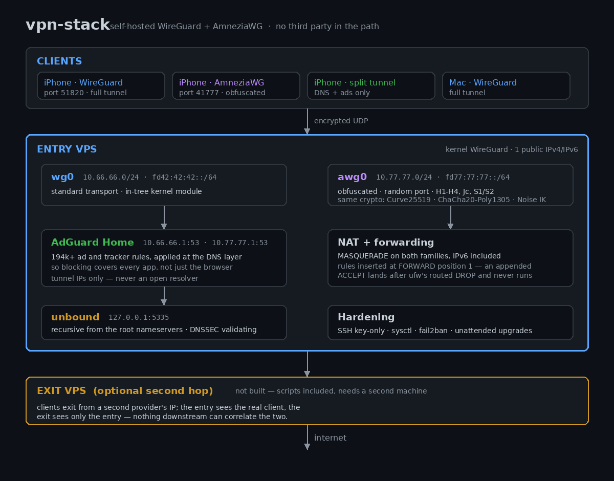

# vpn-stack

A hardened, obfuscation-capable, self-hosted VPN stack on a single VPS — built from
first principles, no third party in the path.

**Status:** work in progress. Layers 0–1 complete; 2–6 in progress.

> **Why self-host?** A commercial VPN asks you to *believe* a no-logs claim.
> This one can be *read*. There is no operator between you and the exit, no
> subscription, no account, and no policy document — just a config file you own.

---

## Architecture



<details>
<summary>Text version (plain terminals / screen readers)</summary>

```
                              ┌─────────────────────────────┐
   iPhone ────┐               │        ENTRY  VPS            │
              │  AmneziaWG    │  ┌───────────────────────┐  │
   MacBook ───┼──(obfuscated)─┼─▶│  awg0                 │  │
              │   UDP :rand   │  │  10.66.66.0/24        │  │
   Laptop ────┘               │  │  fd42:42:42::/64      │  │
                              │  └──────────┬────────────┘  │
                              │             │ NAT + forward │
                              │  ┌──────────▼────────────┐  │
                              │  │  unbound / AdGuard    │  │
                              │  │  DNS + blocklists     │  │
                              │  └───────────────────────┘  │
                              └──────────────┬──────────────┘
                                             │ (optional multi-hop)
                              ┌──────────────▼──────────────┐
                              │        EXIT  VPS             │
                              │   second tunnel, second IP   │
                              └──────────────┬──────────────┘
                                             │
                                        the internet
```

</details>

### Design decisions

| Decision | Choice | Why |
|---|---|---|
| Cryptographic core | WireGuard (`Noise_IK`, Curve25519, ChaCha20-Poly1305) | Audited, tiny, in-kernel |
| Transport signature | **AmneziaWG** obfuscation | Plain WireGuard has a 148-byte handshake signature any DPI box can match |
| Inner IPv4 / IPv6 | `10.66.66.0/24` / `fd42:42:42::/64` | Avoids Docker (`172.16/12`) and Tailscale (`100.64/10`) |
| Kill switch | `includeAllNetworks` | Fails **closed** — the tunnel dropping must not mean traffic leaks |
| DNS | Self-hosted resolver + blocklists | Otherwise every lookup goes to a third party |
| Config storage | Never in the repo | The key *is* the credential |

---

## Features

**Implemented**

- [x] Kernel WireGuard server, IPv4 + IPv6, full-tunnel clients
- [x] AmneziaWG obfuscated transport (DKMS module, randomised headers + padding)
- [x] Boot persistence for every interface, across every bootable kernel
- [x] Firewall handling that survives `ufw`'s `routed DROP` default
- [x] Self-hosted **recursive** DNS (unbound) — no upstream third party sees any query
- [x] Ad/tracker blocking at the DNS layer (194k+ rules, applies to every app)
- [x] DNSSEC validation
- [x] IPv6 leak closed on both transports
- [x] SSH + sysctl hardening, fail2ban, unattended upgrades
- [x] Per-device keys, labelled QR provisioning, rotation, revocation
- [x] Rollback-safe firewall changes (rules backed up before any edit)

**Not built**

- [ ] Kill switch — app-level only; the config-file key commonly cited for it is not a
      WireGuard key and makes iOS reject the whole profile
- [ ] Multi-hop entry → exit — scripts ready, needs a second VPS
- [ ] Monitoring and alerting

---

## Install

```bash
git clone https://github.com/<you>/vpn-stack.git
cd vpn-stack
sudo ./install.sh
```

`install.sh` is idempotent and backs up firewall state before it touches anything.

## Adding a device

```bash
sudo ./scripts/add-device.sh my-phone
# -> writes clients/my-phone.conf
# -> writes clients/my-phone.png   (QR, chmod 600)
# -> adds the peer live, no restart, no disconnection for existing clients

sudo ./scripts/add-device.sh my-laptop --awg     # obfuscated transport
sudo ./scripts/add-device.sh my-phone --split    # route only the VPN subnet
```

## Revoking / rotating keys

```bash
sudo ./scripts/rotate-keys.sh                 # all devices
sudo ./scripts/rotate-keys.sh my-phone        # one device
sudo ./scripts/remove-device.sh my-phone      # revoke a lost or leaked device
```

## Status

```bash
sudo ./scripts/status.sh
```

---

## Security notes

- **The client config is the credential.** Anyone holding it can use the tunnel.
  It is `chmod 600`, excluded via `.gitignore`, and should be deleted from chat
  history after import. Rotation is one command.
- **WireGuard logs nothing by design.** There are no connection logs to leak
  because none are written.
- **The server is the attack surface, not the tunnel.** The real risk on a box
  like this is SSH, not WireGuard. Key-only auth, no root login, and unattended
  upgrades matter more than anything in the tunnel config.
- **Nothing here evades lawful process or is intended for illegal use.** VPNs are
  a standard privacy tool; obfuscation is a mainstream feature every major
  commercial provider sells.

## Honest limitations

- **One IP address.** A commercial provider's real product is an IP *pool* of
  thousands — enough that no site can block them. A self-hosted exit has one.
  If you get blocked somewhere, you stay blocked.
- **No global peering.** You get your VPS provider's network path, not a
  purpose-built backbone.
- **You are the operator.** No support desk. A misconfiguration locks you out.

## Docs

- **[Verification and benchmarks](docs/benchmarks.md)** — measured numbers, the method behind
  each, and an explicit list of what was *not* measured
- **[Troubleshooting](docs/troubleshooting.md)** — the failures that cost real time and all
  present as something other than their cause

## License

MIT — see [LICENSE](LICENSE).
